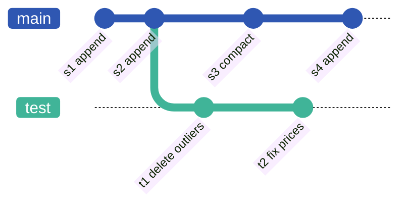

# Data Formats and Data Lakes

From CSV to Parquet, from data lakes to lakehouses

---
layout: two-cols-header
columns: 50fr 50fr
---

# Introduction

::left::

## Previous lectures

- Data warehouses: schema, querying
- Database components underneath

## This lecture

- Trend: open table formats
- From monolithic database systems to disaggregated ones: file format, table format, engine

::right::

<div class="arch">
<div class="arch-col">
<div class="arch-title">Traditional DBMS</div>
<div class="arch-mono">
<div class="arch-layer" style="background: var(--tint-blue)">SQL, optimizer, execution</div>
<div class="arch-layer" style="background: var(--tint-purple)">transactions</div>
<div class="arch-layer" style="background: var(--tint-teal)">storage engine<small>proprietary format</small></div>
<div class="arch-layer" style="background: var(--tint-yellow)">local disks</div>
</div>
</div>
<div class="arch-col">
<div class="arch-title">Disaggregated</div>
<div class="arch-mono arch-split" style="border-color: transparent; padding: 0">
<div class="arch-layer" style="background: var(--tint-blue)">engines<small>DuckDB, Spark, Trino, Python</small></div>
<div class="arch-layer" style="background: var(--tint-purple)">table format<small>Iceberg, Delta Lake, DuckLake</small></div>
<div class="arch-layer" style="background: var(--tint-teal)">file format<small>Parquet</small></div>
<div class="arch-layer" style="background: var(--tint-yellow)">object store<small>S3, GCS, Azure Blob</small></div>
</div>
</div>
</div>

---
layout: two-cols-header
columns: 52fr 48fr
transition: slide-fade-left | slide-fade-right
---

<script setup lang="ts">
import { onMounted } from 'vue'
import { useTl } from 'slidev-addon-gsap'

const tl = useTl()
onMounted(() => {
  tl.step()
    // click 1: any engine could read the data, but the format is proprietary
    .fadeIn('.q-why')
    .fadeOut('.lbl-a', {}, '<')
    .fadeIn('.lbl-b', {}, '<')
    .fadeIn('.store-tag', {}, '<')
    .step()
    // click 2: and writers need coordination
    .fadeIn('.q-write')
    .step()
})
</script>

# Disaggregation

::left::

## Separating compute and storage

- Workers decoupled from the storage layer
- Compute scales independently of the data: any number of readers

<div class="q-why">

## Open questions

- Why only one type of worker? → proprietary on-disk formats

</div>
<div class="q-write">

- How do concurrent writers coordinate?

::takeaway{label="This lecture"}
Open formats readable by any engine, and safe concurrent writes
::

</div>

::right::

<div class="nodes">
<div class="node"><span class="lbl-a">worker</span><span class="lbl-b">DuckDB</span></div>
<div class="node"><span class="lbl-a">worker</span><span class="lbl-b">Spark</span></div>
<div class="node"><span class="lbl-a">worker</span><span class="lbl-b">Python</span></div>
<div class="node"><span class="lbl-a">worker</span><span class="lbl-b">Trino</span></div>
<div class="node more">…</div>
</div>
<div class="store">
<div class="store-title">shared storage <span class="store-tag">proprietary format</span></div>
</div>

---
layout: default
transition: slide-fade-left | slide-fade-right
---

# Contents

1. Open data formats
   - CSV and its limits, step by step towards Parquet
2. Data lakes
   - Object stores, reading Parquet over HTTP
3. Open table formats
   - From data lakes to lakehouses
   - Comparison with traditional DBMSs
   - LTAP: transactions and analytics on one copy in the lake


---
layout: section-num
num: 1
transition: slide-fade-left | slide-fade-right
---

# Open Data Formats

From CSV to Parquet

---
layout: default
codeSize: 12px
---

# Basic Data Formats

## Known from DBE

- JSON, XML: semi-structured data
- CSV: tabular data

<div class="flex gap-8 mt-3">
<div>

```json [JSON]
{
  "created_at": "2026-10-08",
  "product_id": 101,
  "country": "Germany",
  "revenue": 19.99
}
```

</div>
<div>

```xml [XML]
<order>
  <created_at>2026-10-08</created_at>
  <product_id>101</product_id>
  <country>Germany</country>
  <revenue>19.99</revenue>
</order>
```

</div>
<div>

```text [CSV]
created_at,product_id,country,revenue
2026-10-08,101,Germany,19.99
```

</div>
</div>

## Focus of this part

- CSV: strengths, weaknesses, and a step-by-step evolution towards a modern format

---
layout: two-cols-header
columns: 52fr 48fr
---

# CSV

::left::

## Format

- One record per line, fields separated by commas
- Optional header line with column names
- Fields containing `,`, `"` or line breaks are quoted; `"` is escaped as `""` ([RFC 4180](https://www.rfc-editor.org/rfc/rfc4180))

## Strengths

- Plain text, human-readable
- Supported by virtually every tool

::right::

```text [shops.csv]
name,city,note
Delikatessen Kurze,Dresden,
"Müller, Söhne & Co.",Leipzig,"says ""hi"""
```

---
layout: two-cols-header
columns: 45fr 55fr
transition: fade
---

# CSV Limits

::left::

## A storage format for databases?

<v-clicks>

- No data types; NULL and empty string look the same
- No validation of column assignment
- Escaping of `"` and `,`
- Numbers stored as text: parsed on every read
- One byte per character: `1401` takes 4 bytes instead of 2
- Access to line N requires reading all preceding lines
- Inconsistent implementations, e.g. German Excel: `;` separator, `19,99`

</v-clicks>

::right::

<FileView stage="csv" />

<p class="fig-note">Running example: orders of a web shop</p>

---
layout: two-cols-header
columns: 45fr 55fr
transition: fade
---

<script setup lang="ts">
import { onMounted } from 'vue'
import { useTl } from 'slidev-addon-gsap'

const tl = useTl()
onMounted(() => {
  tl.step()
    // click 1: without colour (= without a schema) the bytes carry no type
    .to('.fv', { '--sat': 0, duration: 0.6 })
    .to('.fv-legend', { opacity: 0, duration: 0.4 }, '<')
    .fadeIn('.t-trash', {}, '<')
    .step()
    // click 2: a schema in the footer describes the bytes
    .fadeIn('.fv-footer')
    .to('.fv', { '--sat': 1, duration: 0.6 }, '<')
    .to('.fv-legend', { opacity: 1, duration: 0.4 }, '<')
    .fadeIn('.t-schema', {}, '<')
    .step()
})
</script>

# Binary Data

::left::

## Idea

- Binary values instead of text
  - `INT32`, `DATE`: 4 bytes
  - `DECIMAL(10,2)`: 8-byte integer, `19.99` → `1999`
  - Strings: 4-byte length prefix + characters
- No delimiters, no parsing

<div class="t-trash">

## Problem

- Raw bytes carry no type information

</div>
<div class="t-schema">

## Solution

- Schema metadata in a **footer** at the end of the file
  - Written last, so it can later hold offsets and statistics of the data

</div>

::right::

<FileView stage="binary" />

---
layout: two-cols-header
columns: 45fr 55fr
transition: fade
---

<script setup lang="ts">
import { onMounted } from 'vue'
import { useTl } from 'slidev-addon-gsap'

const tl = useTl()
onMounted(() => {
  tl.step()
    // click 1: row 7 sits at a fixed offset
    .to('.fv-cell:not(.fv-p7)', { opacity: 0.25, duration: 0.4 })
    .fadeIn('.t-row', {}, '<')
    .step()
    // click 2: so does revenue in every row
    .to('.fv-cell:not(.fv-c3)', { opacity: 0.25, duration: 0.4 })
    .to('.fv-cell.fv-c3', { opacity: 1, duration: 0.4 }, '<')
    .fadeIn('.t-sum', {}, '<')
    .step()
})
</script>

# Fixed Size Data

::left::

## Problem

- Variable-length rows: finding a value requires scanning all preceding rows
  - e.g. `{sql} SELECT sum(revenue) FROM orders`
- DBMSs maintain an offset list per row

## Fixed-size values

- Strings replaced by ids into a **dictionary** in the footer
- Constant row size: 20 bytes

<div class="t-row">

- Row 7: `file[7 * 20]`

</div>
<div class="t-sum">

- `sum(revenue)`: `file[i * 20 + 12]` for every row i
- String interning: each distinct string stored once

</div>

::right::

<FileView stage="fixed" />

---
layout: two-cols-header
columns: 45fr 55fr
transition: fade
---

<script setup lang="ts">
import { onMounted } from 'vue'
import { useTl } from 'slidev-addon-gsap'

const tl = useTl()
onMounted(() => {
  tl.step()
    // click 1: summing revenue reads one contiguous range
    .to('.fv-cell:not(.fv-c3)', { opacity: 0.25, duration: 0.4 })
    .fadeIn('.t-sum', {}, '<')
    .step()
})
</script>

# Columnar Data

::left::

## Problem

- Analytical queries access few columns; DWH tables often have hundreds
- Row layout: most of every loaded page is skipped

## Columnar layout

- Each column stored contiguously

<div class="t-sum">

- `sum(revenue)`: one sequential range, `file[108:180]`
- Sequential access, SIMD vectorisation by the compiler

</div>

- Trade-off: the file is no longer human-readable

::right::

<FileView stage="columnar" />

---
layout: two-cols-header
columns: 45fr 55fr
transition: fade
---

<script setup lang="ts">
import { onMounted } from 'vue'
import { useTl } from 'slidev-addon-gsap'

const tl = useTl()
onMounted(() => {
  tl.step()
    // click 1: a whole row stays inside one row group
    .to('.fv-cell:not(.fv-r4)', { opacity: 0.25, duration: 0.4 })
    .fadeIn('.t-local', {}, '<')
    .step()
})
</script>

# PAX Layout

::left::

## Problem

- Reconstructing a row: one access per column, potentially GBs apart

## Partition Attributes Across (PAX)

- Columnar layout within horizontal partitions
- Partition = **row group** (also: stripe, RecordBatch, micro-partition)
- Parquet: row groups of 128 MB – 1 GB

<div class="t-local">

- A row lies within one row group; column scans remain mostly sequential

</div>

<p class="ref"><a href="https://research.cs.wisc.edu/multifacet/papers/vldbj02_pax.pdf">Ailamaki et al.: Data page layouts for relational databases on deep memory hierarchies. VLDB J. 2002</a></p>

::right::

<FileView stage="rowgroups" />

---
layout: two-cols-header
columns: 45fr 55fr
transition: fade
---

<script setup lang="ts">
import { onMounted } from 'vue'
import { useTl } from 'slidev-addon-gsap'

const tl = useTl()
onMounted(() => {
  tl.step()
    // click 1: the index finds rows 2, 4 and 5, spread over two row groups
    .to('.ix-entry:not(.ix-k2)', { opacity: 0.25, duration: 0.4 })
    .to('.fv-cell:not(.fv-p2, .fv-p4, .fv-p5)', { opacity: 0.25, duration: 0.4 }, '<')
    .fadeIn('.t-q', {}, '<')
    .step()
    // click 2: best of both worlds?
    .fadeIn('.t-best')
    .step()
})
</script>

# Index or Scan?

::left::

## External index

- B⁺-tree outside the file: value → row positions
- Lookup: tree traversal, then a random read per row
- Only for selective queries (< ~5 % of rows)

<div class="t-q">

- `{sql} created_at = '2026-10-10'`: rows 2, 4, 5, in two row groups

</div>

## Scan

- Sequential read, drop non-matching rows
- Faster per row on modern CPUs

<div class="t-best">

::takeaway{label="Question"}
Best of both worlds? Not quite, but zone maps come close
::

</div>

::right::

<FileView stage="rowgroups" />

<IndexTree class="mt-5" />

---
layout: two-cols-header
columns: 45fr 55fr
transition: fade
---

<script setup lang="ts">
import { onMounted } from 'vue'
import { useTl } from 'slidev-addon-gsap'

const tl = useTl()
onMounted(() => {
  tl.step()
    // click 1: every row group's created_at range contains 10-10
    .to('.fv-cell:not(.fv-c0.fv-r3, .fv-c0.fv-r4, .fv-c0.fv-r5)', { opacity: 0.25, duration: 0.4 })
    .fadeIn('.t-q', {}, '<')
    .step()
})
</script>

# Zone Maps (1)

::left::

## Zone maps

- Small metadata per row group and column: min, max, count, null count, …
- Stored in the footer: a few bytes per row group
- Row groups that cannot match are skipped without reading them

<div class="t-q">

- `{sql} WHERE created_at = '2026-10-10'`: no row group skipped; row group 2 is read without containing a match

</div>

::right::

<FileView stage="zonemaps" />

---
layout: two-cols-header
columns: 45fr 55fr
transition: fade
---

<script setup lang="ts">
import { onMounted } from 'vue'
import { useTl } from 'slidev-addon-gsap'

const tl = useTl()
onMounted(() => {
  tl.step()
    // click 1: sorted by arrival, only row group 1 can hold 10-10
    .to('.fv-rg:is(.fv-g0, .fv-g2), .fv-zones :is(.fv-zg0, .fv-zg2)', { opacity: 0.25, duration: 0.4 })
    .fadeIn('.t-date', {}, '<')
    .step()
    // click 2: new products have higher ids, so product 112 is only in row group 2
    .to('.fv-rg.fv-g1, .fv-zones .fv-zg1', { opacity: 0.25, duration: 0.4 })
    .to('.fv-rg.fv-g2, .fv-zones .fv-zg2', { opacity: 1, duration: 0.4 }, '<')
    .fadeIn('.t-product', {}, '<')
    .step()
})
</script>

# Zone Maps (2)

::left::

## Natural clustering

- Rows usually arrive roughly in time order
- Insertion order clusters `created_at`

<div class="t-date">

- `{sql} created_at = '2026-10-10'`: only row group 1 is read

</div>
<div class="t-product">

## Implicit clustering

- New products receive higher ids
- `{sql} product_id = 112`: only row group 2 is read

</div>

<p class="ref"><a href="https://pi3.informatik.uni-mannheim.de/~moer/Publications/MA-98-01.pdf">Moerkotte: Small Materialized Aggregates. VLDB 1998</a></p>

::right::

<FileView stage="zonemaps" order="arrival" />

---
layout: default
---

# Compression

## Motivation

- The file is no longer human-readable anyway: optimise it for size
- Decoding costs some CPU time, but less data has to be loaded

## Two families

| | Lightweight | Heavyweight |
|:--|:--|:--|
| Works on | values of one column | blocks of bytes, e.g. a column chunk |
| Exploits | small, missing, repeated or sorted values | repeated byte sequences |
| Decoding | very fast, value by value | whole block at once, slower |
| Examples | bit-packing, NULL bitmap, dictionary, RLE, delta | gzip (deflate), Snappy, LZ4, Zstd |

- The boundary between the two is fuzzy

---
layout: two-cols-header
columns: 45fr 55fr
---

<script setup lang="ts">
import { onMounted } from 'vue'
import { useTl } from 'slidev-addon-gsap'

const ids = [101, 103, 101, 104]
const discount = [null, null, '5.00', null, null, null, '10.00', null, null]
const valid = discount.map(d => (d === null ? 0 : 1))
const present = discount.filter(d => d !== null)

const tl = useTl()
onMounted(() => {
  tl.step()
    // click 1: drop the leading zeros, pack the 7 significant bits back to back
    .to('.ids .bt-pads', { opacity: 0.25, duration: 0.4 })
    .fadeIn('.t-pack', {}, '<')
    .morph('.ids .bt-v0 .bt-sigs', '.packed .bt-v0', { keep: true, duration: 0.4 })
    .morph('.ids .bt-v1 .bt-sigs', '.packed .bt-v1', { keep: true, duration: 0.4 })
    .morph('.ids .bt-v2 .bt-sigs', '.packed .bt-v2', { keep: true, duration: 0.4 })
    .morph('.ids .bt-v3 .bt-sigs', '.packed .bt-v3', { keep: true, duration: 0.4 })
    .step()
    // click 2: NULLs take no slot, only a bit
    .fadeIn('.t-null')
    .step()
})
</script>

# Bit-Packing and NULL Bitmaps

::left::

## Bit-packing

- Small integers waste most of their 32 bits on leading zeros
- Each value gets only the bits the block's largest value needs
- `product_id` ≤ 112 < 2⁷: 7 instead of 32 bits
- Classic term: null suppression ("null" = zero bytes, not SQL NULL)

<div class="t-null">

## NULL bitmap

- No placeholder slot for missing values
- One bit per row: value present or NULL
- Only the present values are stored

</div>

::right::

<Bits class="ids" caption="product_id INT32" :values="ids" :width="32" :sig="7" note="128 bits" />
<div class="t-pack mt-3">
<Bits class="packed" caption="bit-packed: 7 bits per value" :values="ids" :width="7" packed note="28 bits" />
</div>
<div class="t-null mt-6">
<Cells caption="discount DECIMAL(10,2): an 8-byte slot per row" :vals="discount" tint="red" :w="44" note="72 B" />
<div class="flex items-end gap-4 mt-3">
<Bits caption="NULL bitmap" :values="valid" :width="1" packed tint="red" />
<Cells caption="present values" :vals="present" tint="red" :w="44" note="2 B + 16 B" />
</div>
</div>

---
layout: two-cols-header
columns: 45fr 55fr
---

<script setup lang="ts">
import { onMounted } from 'vue'
import { useTl } from 'slidev-addon-gsap'

const country = ['Germany', 'France', 'Germany', 'Germany', 'Poland', 'Germany', 'France', 'Germany', 'Poland']
const dict = ['France', 'Germany', 'Poland']
const codes = country.map(c => dict.indexOf(c))
const entries = dict.map((s, i) => `${i} ${s}`)
const days = ['10-08', '10-08', '10-09', '10-10', '10-10', '10-10', '10-11', '10-12', '10-12']
const runs = ['10-08 ×2', '10-09 ×1', '10-10 ×3', '10-11 ×1', '10-12 ×2']
const runLengths = [2, 1, 3, 1, 2]

const tl = useTl()
onMounted(() => {
  tl.step()
    // click 1: every distinct string once, the rows keep a 2-bit code
    .fadeIn('.t-dict')
    .step()
    // click 2: a sorted column…
    .fadeIn('.t-rle')
    .step()
    // click 3: …collapses into runs
    .fadeIn('.t-runs')
    .step()
})
</script>

# Dictionary and Run-Length Encoding

::left::

## Dictionary encoding

- Each distinct value stored once, in a dictionary
- Values replaced by integer codes
- Codes are small: bit-packed, 3 countries need 2 bits

<div class="t-rle">

## Run-length encoding (RLE)

- A run of equal values becomes one (value, count) pair
- Effective on sorted or clustered columns
- Parquet stores dictionary codes RLE / bit-packed

</div>

::right::

<Cells caption="country STRING" :vals="country" tint="yellow" :w="50" />
<div class="t-dict mt-3">
<Cells caption="codes: 2 bits each" :vals="codes" tint="yellow" :w="50" />
<Cells class="mt-3" caption="dictionary" :vals="entries" tint="yellow" />
</div>
<div class="t-rle mt-6">
<Cells caption="created_at DATE, in arrival order" :vals="days" tint="blue" :w="50" />
<Cells class="t-runs mt-3" caption="runs: value × count" :vals="runs" :spans="runLengths" tint="blue" :w="50" />
</div>

---
layout: two-cols-header
columns: 45fr 55fr
---

<script setup lang="ts">
import { onMounted } from 'vue'
import { useTl } from 'slidev-addon-gsap'

const ids = [100231, 100233, 100234, 100237, 100238, 100241]
const deltas = ids.slice(1).map((id, i) => id - ids[i])
const encoded = [ids[0], ...deltas.map(d => `+${d}`)]

const tl = useTl()
onMounted(() => {
  tl.step()
    // click 1: differences to the previous id
    .fadeIn('.t-delta')
    .step()
    // click 2: the differences need only 2 bits each
    .fadeIn('.t-casc')
    .step()
})
</script>

# Delta Encoding and Cascades

::left::

## Delta encoding

- Store the difference to the previous value
- Small differences in sorted or increasing columns: ids, timestamps
- Decoding is a running sum: one start value per block

<div class="t-casc">

## Cascades

- One encoding makes the values small, the next stores them compactly
- Delta → bit-packing: 2 instead of 17 bits per value
- Frame of reference → bit-packing: subtract the block minimum, 4 bits
- Also common: dictionary → bit-packing, dictionary → RLE

</div>

::right::

<Cells caption="order_id INT32: bit-packing alone needs 17 bits" :vals="ids" tint="purple" :w="50" note="192 bits" />
<Cells class="t-delta mt-3" caption="delta encoding" :vals="encoded" tint="purple" :w="50" />
<div class="t-casc flex items-end gap-4 mt-3">
<Cells caption="first value" :vals="[ids[0]]" tint="purple" :w="50" />
<Bits caption="deltas, bit-packed: 2 bits each" :values="deltas" :width="2" packed tint="purple" note="32 + 5 × 2 = 42 bits" />
</div>

---
layout: two-cols-header
columns: 45fr 55fr
---

<script setup lang="ts">
import { onMounted } from 'vue'
import { useTl } from 'slidev-addon-gsap'

const tl = useTl()
onMounted(() => {
  tl.step()
    // click 1: Parquet puts a codec on top of the encodings
    .fadeIn('.t-parquet')
    .step()
})
</script>

# Heavyweight Compression

::left::

## Idea

- General purpose: works on any bytes, also text
- LZ77 family: a repeated byte sequence becomes a back-reference (distance, length)
- Often followed by entropy coding (e.g. Huffman): frequent symbols get shorter codes

## Trade-offs

- Good on irregular data; slower to compress and decompress
- Blocks are decompressed as a whole, even to read one value
- Snappy, LZ4: LZ77 only, fast; gzip, Zstd: with entropy coding, smaller

::right::

<div class="t-parquet">
<div class="pipe">
<div class="arch-layer" style="background: var(--tint-purple)">encodings<small>dictionary, RLE, delta, …</small></div>
<FlowArrow />
<div class="arch-layer" style="background: var(--tint-teal)">codec (optional)<small>Snappy, gzip, Zstd, …</small></div>
</div>
<p class="fig-note">Parquet: encodings first, then an optional codec</p>

::takeaway{label="What to use?"}
Depends on format, workload and data: decided case by case
::

</div>

---
layout: two-cols-header
columns: 45fr 55fr
transition: slide-fade-left | slide-fade-right
---

<script setup lang="ts">
import { onMounted } from 'vue'
import { useTl } from 'slidev-addon-gsap'

const tl = useTl()
onMounted(() => {
  tl.step()
    .fadeIn('.t-limits')
    .step()
})
</script>

# Apache Parquet

::left::

## Result

- Columnar, compressed, self-describing: **Apache Parquet**, the de facto standard for analytical data
- Not to be confused with **Apache Arrow**: columnar, in memory

## Open research questions

- Benefit of heavyweight compression ([Vortex](https://docs.vortex.dev/specs/file-format): lightweight cascades, Zstd only in its size-optimised mode)
- New encodings without breaking existing readers ([AnyBlox](https://www.cs.cit.tum.de/fileadmin/w00cfj/dis/papers/anyblox.pdf), [F3](https://dl.acm.org/doi/pdf/10.1145/3749163))

<div class="t-limits">

::takeaway{label="Limitations" color="red"}
No updates or deletes, no coordination of concurrent writers
::

</div>

::right::

<FileView stage="parquet" order="arrival" />

---
layout: default
transition: slide-fade-left | slide-fade-right
---

<script setup lang="ts">
import { onMounted } from 'vue'
import { useTl } from 'slidev-addon-gsap'

const tl = useTl()
onMounted(() => {
  tl.step()
    // click 1: what else exists in that direction
    .fadeIn('.recap :is(th, td):nth-child(3)')
    .step()
})
</script>

# Summary: Open Data Formats

<div class="recap table-w">

| | Shown | Alternatives |
|:--|:--|:--|
| Layout | Rows (CSV), columns, PAX row groups (Parquet) | ORC: PAX as well (stripes), from the Hive ecosystem<br>Avro: rows, cheap to append record by record (Kafka, Iceberg manifests) |
| Skipping | Zone maps per row group | Finer: Parquet page index, ORC index every 10,000 rows<br>Bloom filters for equality filters (Parquet, ORC) |
| Compression | Lightweight encodings, optional codec | Vortex: cascades of lightweight encodings, filters on compressed data<br>Arrow IPC (Feather): the in-memory layout as a file, fast to read but larger |
| Access pattern | Large scans | Lance: fast random access to single rows, vector indexes, for ML |

</div>

---
layout: section-num
num: 2
transition: slide-fade-left | slide-fade-right
---

# Data Lakes

Object stores and open file formats

---
layout: two-cols-header
columns: 45fr 55fr
transition: fade
---

# Data Lakes (1)

::left::

## Definition

- Repository of data in its raw form
- Widespread since the 2010s

## In practice

- Scalable object store (e.g. S3) holding large datasets, often in Parquet
- Accessed by many heterogeneous systems
- Constraint: objects are immutable

::right::

<div class="nodes">
<div class="node">Python script</div>
<div class="node">DuckDB</div>
<div class="node">Superset via Trino</div>
<div class="node more">…</div>
</div>
<div class="store">
<div class="store-title mb-1">object store</div>

<LakeTree stage="single" />

</div>
<p class="fig-note">Clients read the files directly from the object store.</p>

---
layout: two-cols-header
columns: 52fr 48fr
transition: slide-fade-left | slide-fade-right
---

<script setup lang="ts">
import { onMounted } from 'vue'
import { useTl } from 'slidev-addon-gsap'

const tl = useTl()
// lines of the request log
const line = (...n: number[]) => n.map(i => `.slidev-code .line:nth-child(${i})`).join(', ')
onMounted(() => {
  tl.step()
    // click 1: a suffix range reads the last 8 bytes, the footer length
    .fadeIn(`${line(1)}, .br-r1`)
    .from('.br-s1', { opacity: 0.35, duration: 0.4 }, '<')
    .step()
    // click 2: the footer, with the offset of every column chunk
    .to(`${line(1)}, .br-r1`, { opacity: 0.35, duration: 0.4 })
    .fadeIn(`${line(2, 3)}, .br-r2`, {}, '<')
    .from('.br-s2', { opacity: 0.35, duration: 0.4 }, '<')
    .step()
    // click 3: the revenue chunk of row group 17, at an offset from the footer
    .to(`${line(2, 3)}, .br-r2`, { opacity: 0.35, duration: 0.4 })
    .fadeIn(`${line(4)}, .br-r3`, {}, '<')
    .from('.br-s3', { opacity: 0.35, duration: 0.4 }, '<')
    .step()
    // click 4: the same for row group 18
    .to(`${line(4)}, .br-r3`, { opacity: 0.35, duration: 0.4 })
    .fadeIn(`${line(5)}, .br-r4`, {}, '<')
    .from('.br-s4', { opacity: 0.35, duration: 0.4 }, '<')
    .step()
    // click 5: all four requests, and the total
    .to(`${line(1, 2, 3, 4)}, .br-r1, .br-r2, .br-r3`, { opacity: 1, duration: 0.4 })
    .fadeIn(line(7), {}, '<')
    .step()
})
</script>

# Data Lakes (2)

::left::

## Object stores

- Flat namespace, no real directories
- Immutable objects: every change rewrites the whole object
- High latency per request, virtually unlimited scalability
- Parallel scans: hundreds of servers reading one file

## Clients

- Any system that speaks S3 (HTTP) and Parquet: programming languages, databases
- BI tools through such an engine

::right::

```text [Query via HTTP range requests]
GET orders.parquet  Range: bytes=-8      → footer length
GET orders.parquet  Range: bytes=-1.2MB  → footer: schema,
                                           offsets, zone maps
GET orders.parquet  Range: rg 17 revenue → 4 MB
GET orders.parquet  Range: rg 18 revenue → 4 MB

4 requests, 9 MB of a 10 GB object
```

<ByteRanges class="mt-8" />
<p class="fig-note">orders.parquet, not to scale: 20 row groups of 512 MB, then the footer, then 8 bytes (footer length, PAR1).</p>

---
layout: section-num
num: 3
transition: slide-fade-left | slide-fade-right
---

# Open Table Formats

From data lakes to lakehouses

---
layout: two-cols-header
columns: 50fr 50fr
transition: fade
---

# Mutability on Immutable Storage

::left::

## Approach: one file per change

- Insert: new file
- Delete: rewrite the affected file
- Update: delete + insert
- Sufficient for many systems: append-only workloads are common

## Issues

- <Issue n="1" /> one file per small write
- <Issue n="2" /> for every delete or update
- <Issue n="3" /> on the same files
- <Issue n="4" /> by every query

::right::

<LakeTree stage="flat" />

---
layout: two-cols-header
columns: 50fr 50fr
transition: fade
---

<script setup lang="ts">
import { onMounted } from 'vue'
import { useTl } from 'slidev-addon-gsap'

const tl = useTl()
onMounted(() => {
  tl.step()
    // click 1: the newest partition is just a prefix listing
    .to('.lt-line:not(.lt-k-root, .lt-k-d10, .lt-k-002, .lt-k-003, .lt-k-004)', { opacity: 0.3, duration: 0.4 })
    .fadeIn('.t-prefix', {}, '<')
    .step()
    // click 2: what partitioning does not solve
    .fadeIn('.t-pitfalls')
    .step()
})
</script>

# Hive Partitioning <Issue n="4" solved />

::left::

## Idea

- Partition files by a frequently filtered dimension (e.g. date, country)
- One directory per partition value: `/year=…/month=…/`
- Older partitions are rarely read and rarely written

<div class="t-prefix">

## Partition pruning

- Recent data via a prefix listing:

```sql
SELECT sum(revenue)
FROM 's3://lake/orders/year=2026/month=10/*.parquet';
```

</div>
<div class="t-pitfalls">

## Pitfalls

- Too fine partitions: <Issue n="1" /> again
- Filter on `created_at` alone: no pruning (Iceberg: hidden partitioning)
- Listing many prefixes is slow: 1,000 keys per request

</div>

::right::

<LakeTree stage="hive" />

---
layout: two-cols-header
columns: 50fr 50fr
transition: fade
---

# Compaction <Issue n="1" solved /> <Issue n="4" solved />

::left::

## Idea

- Periodically merge small files into larger ones
- Selection policy, e.g. files of the last day or below a size threshold

## Implementation

- Read the files, write one new file, delete the originals:

```sql
COPY (SELECT * FROM read_parquet(['…/part-002.parquet', …])
      ORDER BY created_at, country)  -- optional: better zone maps
TO 's3://lake/orders/year=2026/month=10/compact.parquet';
```

::takeaway{label="Problem" color="red"}
Readers between writing and deleting see duplicate rows: <Issue n="3" /> gets worse
::

::right::

<LakeTree stage="compact" />

---
layout: two-cols-header
columns: 50fr 50fr
transition: fade
---

# Snapshots (1) <Issue n="3" solved />

::left::

## Snapshot isolation

- Inspired by MVCC in monolithic DBMSs
- Linear, atomic snapshot ids
- Central metadata store: which files belong to which snapshot

## Operations

- New files are invisible until committed to the metadata
- Delete: remove the file from the metadata
- Compaction: remove old and add new files in one atomic commit

<p class="ref"><a href="https://www.vldb.org/pvldb/vol13/p3411-armbrust.pdf">Armbrust et al.: Delta Lake: High-Performance ACID Table Storage over Cloud Object Stores. PVLDB 2020</a></p>

::right::

<LakeTree stage="snapshots" />

---
layout: two-cols-header
columns: 50fr 50fr
---

# Snapshots (2)

::left::

## Concurrent writers

- **Pessimistic**: writers acquire a lock in the metadata store
- **Optimistic**: write first, validate at commit time
  - Conflicts are rare: existing files are never modified
  - Writers run fully in parallel

## Atomic commit

- Object stores have no transactions: each commit is one compare-and-swap
  - Iceberg: swap the metadata pointer in a catalog
  - Delta Lake: create the next log file, put-if-absent
  - DuckLake: one SQL transaction

::right::

## Metadata location

- **Object store** (Delta Lake: `_delta_log/`)
  - Pro: no additional infrastructure, self-contained
  - Con: additional round-trips per query
- **External database** (DuckLake)
  - Pro: low latency, higher performance
  - Con: additional infrastructure
- **Iceberg**: metadata files in the object store, pointer to the current one in a catalog

---
layout: two-cols-header
columns: 40fr 60fr
codeSize: 12px
---

# Snapshots (3)

::left::

## Metadata structure

- List of snapshots in commit order
- `current-snapshot-id` marks the current one
- Files per snapshot in a separate manifest list
- Commit: validate that the current snapshot is unchanged

::right::

```json [Iceberg table metadata (excerpt)]
"current-snapshot-id" : 1893044843699371523,
"snapshots" : [ {
  "sequence-number" : 1,
  "snapshot-id" : 1893044843699371523,
  "timestamp-ms" : 1731442065673,
  "summary" : {
    "operation" : "append",
    "added-data-files" : "3",
    "added-records" : "14897200",
    "total-data-files" : "3",
    "total-delete-files" : "0"
  },
  "manifest-list" : "s3://peach-lake/…/snap-1893044843699371523-0-b0823e8d….avro",
  "schema-id" : 0
} ]
```

---
layout: two-cols-header
columns: 50fr 50fr
---

# Branching and Time Travel

::left::

## Branching

- Multiple valid snapshots, similar to git history
- Branch: a parallel line of snapshots
- Changes stay isolated; rollback by switching branches

## Time travel

- Unlisted files are deleted only by a maintenance job (Iceberg `expire_snapshots`, Delta `VACUUM`)
- Retention must outlast the longest query; longer retention (e.g. 30 days) enables queries on old snapshots:

```sql
SELECT * FROM orders TIMESTAMP AS OF '2026-10-10 12:00:00';
```

::right::



---
layout: two-cols-header
columns: 45fr 55fr
---

<script setup lang="ts">
import { onMounted } from 'vue'
import { useTl } from 'slidev-addon-gsap'

const v0 = [[1, 'created_at', 'DATE'], [2, 'product_id', 'INT32'], [3, 'country', 'STRING'], [4, 'revenue', 'DECIMAL(10,2)']]
const v1 = [v0[0], v0[1], [3, 'ship_country', 'STRING'], v0[3], [5, 'discount', 'DECIMAL(10,2)']]

const tl = useTl()
onMounted(() => {
  tl.step()
    // click 1: rename a column, add one: only the metadata changes
    .fadeIn('.t-v1')
    .step()
})
</script>

# Schema Evolution

::left::

## Problem

- Every Parquet file stores its own schema
- Plain lake: columns matched by name
- Rename or drop: rewrite every file, or old files no longer match

## Table formats

- Schema versioned in the table metadata (`schema-id`)
- Columns identified by field id, not by name
- Add, drop, rename, widen: metadata only, no file rewritten
- Old files read with the current schema: new columns are NULL

::right::

<div class="flex gap-6 items-start">
<DbTable caption="schema 0 (part-000 written)" :head="['id', 'name', 'type']" :rows="v0" />
<DbTable class="t-v1" caption="schema 1 (current)" :head="['id', 'name', 'type']" :rows="v1" :tints="[null, null, 'yellow', null, 'teal']" />
</div>

<p class="fig-note t-v1">Reading part-000 with schema 1: field 3 becomes ship_country, discount is NULL</p>


---
layout: two-cols-header
columns: 50fr 50fr
---

<script setup lang="ts">
import { onMounted } from 'vue'
import { useTl } from 'slidev-addon-gsap'

const stats = [
  ['part-000', '09-01 … 09-15', '101 … 110'],
  ['part-001-r1', '09-16 … 09-30', '101 … 111'],
  ['compact', '10-01 … 10-12', '101 … 112'],
]

const tl = useTl()
onMounted(() => {
  tl.step()
    // click 1: one look at the metadata rules out two of the three files
    .to('.stats :is(.r1, .r2)', { opacity: 0.3, duration: 0.4 })
    .fadeIn('.t-query', {}, '<')
    .step()
})
</script>

# Centralised Pruning Metadata <Issue n="4" solved />

::left::

## Problem

- Pruning requires opening every file's footer first
- High object-store latency, costly for small queries

## Solution

- Copy of every file's zone maps in the metadata store
- Metadata alone identifies the relevant files
- Row groups within them: pruned via their footers
- Petabyte-scale tables queryable from a laptop

::right::

<DbTable class="stats" caption="Per-file zone maps in the metadata store" :head="['file', 'created_at', 'product_id']" :rows="stats" />

<div class="t-query mt-4">

`{sql} WHERE product_id = 112` → only `compact.parquet` is opened

</div>

---
layout: two-cols-header
columns: 55fr 45fr
---

<script setup lang="ts">
const part = [[0, '2026-09-01', 101], [1, '2026-09-01', 104], [2, '2026-09-02', 101], [3, '2026-09-02', 107]]
const vector = [[0, 1], [1, 0], [2, 1], [3, 0]]
</script>

# Updates and Deletes <Issue n="2" solved />

::left::

## Copy-on-write (naive)

- Update = delete + insert
- Delete: rewrite the file without the row (hundreds of MB per row)
- Acceptable for workloads with rare deletes

## Merge-on-read: delete files

- **Deletion vectors**: (compressed) bitmap of deleted rows per file
  - Writer must find the rows first; scans stay cheap
- **Equality deletes**: predicate, e.g. `{sql} product_id = 101`
  - Applies to all older files: written blind, checked by every scan
- Many deleted rows slow down scans → combine with compaction

::right::

<div class="flex gap-6 items-start">
<DbTable caption="part-000.parquet" :head="['row', 'created_at', 'product_id']" :rows="part" :tints="['red', null, 'red', null]" />
<DbTable caption="deletion vector" :head="['row', 'deleted']" :rows="vector" :tints="['red', null, 'red', null]" />
</div>

<p class="fig-note">Equality delete <code>product_id = 101</code>: removes product 101 from all older files, not just this one</p>

---
layout: two-cols-header
columns: 50fr 50fr
---

<script setup lang="ts">
import { onMounted } from 'vue'
import { useTl } from 'slidev-addon-gsap'

// rows 9–11 of orders, inserted one by one after snap-3
const inlined = [
  [9, 4, 'NULL', '2026-10-13', 104],
  [10, 5, 'NULL', '2026-10-13', 112],
  [11, 6, 'NULL', '2026-10-14', 101],
]

const tl = useTl()
onMounted(() => {
  tl.step()
    // click 1: buffer in the writer, flush one file
    .fadeIn('.t-batch')
    .step()
    // click 2: or keep small writes in the catalog database
    .fadeIn('.t-inline')
    .step()
})
</script>

# Batching <Issue n="1" solved />

::left::

## Problem

- Each small write: a tiny file and a snapshot
- Compaction fixes the files, not the commits

<div class="t-batch">

## Batch before writing

- Buffer rows, flush every N MB or T seconds
- Streaming: one commit per micro-batch
- Price: rows visible only after the flush

</div>
<div class="t-inline">

## Inline small writes (DuckLake)

- Small writes go into the catalog database
- Flushed to Parquet later, in bulk

</div>

::right::

<div class="pipe">
<div class="arch-layer" style="background: var(--tint-blue)">3 × INSERT<small>1 row each</small></div>
<FlowArrow />
<div class="arch-layer" style="background: var(--tint-red)">3 files<small>3 snapshots</small></div>
</div>
<p class="fig-note">Unbatched: a file and a snapshot per insert</p>

<div class="t-batch mt-4">
<div class="pipe">
<div class="arch-layer" style="background: var(--tint-blue)">3 × INSERT<small>1 row each</small></div>
<FlowArrow />
<div class="arch-layer" style="background: var(--tint-yellow)">buffer<small>128 MB or 1 min</small></div>
<FlowArrow />
<div class="arch-layer" style="background: var(--tint-teal)">1 file<small>1 snapshot</small></div>
</div>
<p class="fig-note">Batched: a file and a snapshot per flush</p>
</div>

<div class="t-inline mt-4">
<DbTable caption="catalog DB: inlined rows of orders" :head="['row_id', 'begin_snapshot', 'end_snapshot', 'created_at', 'product_id']" :rows="inlined" />
</div>


---
layout: default
---

# From Data Lake to Lakehouse

## Issues and solutions

| Issue of a plain data lake | Solved by |
|:--|:--|
| <Issue n="1" /> | Compaction, batching, data inlining |
| <Issue n="2" /> | Merge-on-read: deletion vectors, equality deletes |
| <Issue n="3" /> | Snapshots (optimistic or pessimistic commits) |
| <Issue n="4" /> | Hive partitioning, compaction, centralised pruning metadata |

## Lakehouse

- Data lake storage + warehouse features: transactions, schema evolution, time travel, fast queries
- Combinations of these techniques define the open table formats: Apache Iceberg, Delta Lake, Apache Hudi, DuckLake

<p class="ref"><a href="https://www.cidrdb.org/cidr2021/papers/cidr2021_paper17.pdf">Armbrust et al.: Lakehouse: A New Generation of Open Platforms that Unify Data Warehousing and Advanced Analytics. CIDR 2021</a></p>

---
layout: default
---

<script setup lang="ts">
import { onMounted } from 'vue'
import { useTl } from 'slidev-addon-gsap'

const tl = useTl()
onMounted(() => {
  tl.step()
    // click 1: what else exists in that direction
    .fadeIn('.recap :is(th, td):nth-child(3)')
    .step()
})
</script>

# Summary: Open Table Formats

<div class="recap table-w">

| | Shown | Alternatives |
|:--|:--|:--|
| Formats | Iceberg, Delta Lake, DuckLake | Apache Hudi (Uber): upserts by record key, incremental reads<br>Apache Paimon (from Flink): LSM trees, for streaming upserts |
| Commit | Catalog pointer swap (Iceberg), put-if-absent (Delta Lake), SQL transaction (DuckLake) | Hudi: timeline in the object store, locks for concurrent writers |
| Row changes | Copy-on-write, deletion vectors, equality deletes | Hudi: changed rows in row-wise log files, merged on read<br>Paimon: sorted runs, merged on read and by compaction |
| Small writes | Compaction, batching, data inlining | Hudi: inserts first fill up small files<br>Iceberg v4 (proposal): cheaper small commits |
| Layout | Hive partitioning, hidden partitioning | Delta Lake: liquid clustering instead of partitions<br>Hudi, Paimon: hash buckets by key |
| Catalog | Holds Iceberg's metadata pointer | Hive Metastore, AWS Glue, Polaris, Unity Catalog: names, access rights<br>Trend: the catalog decides every commit, multi-table transactions |

</div>

---
layout: default
---

<script setup lang="ts">
import { onMounted } from 'vue'
import { useTl } from 'slidev-addon-gsap'

const tl = useTl()
onMounted(() => {
  tl.step()
    // click 1: which clients
    .fadeIn('.dvl-d1')
    .step()
    // click 2: who is on the data path
    .fadeIn('.dvl-d2')
    .step()
    // click 3: latency per call
    .fadeIn('.dvl-d3')
    .step()
    // click 4: how far it scales
    .fadeIn('.dvl-d4')
    .step()
})
</script>

# Traditional DBMS vs. Lakehouse

<DbmsVsLakehouse />

---
layout: two-cols-header
columns: 50fr 50fr
---

<script setup lang="ts">
import { onMounted } from 'vue'
import { useTl } from 'slidev-addon-gsap'

const tl = useTl()
onMounted(() => {
  tl.step()
    // click 1: freshness and isolation pull in opposite directions
    .fadeIn('.t-tension')
    .step()
})
</script>

# Transactions and Analytics

::left::

## Two workloads

- OLTP: short transactions, point access → rows, WAL, locks / MVCC
- OLAP: large scans → columns, compression, parallelism
- Analytics on recent commits: fraud detection, dashboards, monitoring

<div class="t-tension">

## Trade-off

- Freshness: needs tight coupling to the transactional state
- Isolation: scans must not slow down transactions → decoupling
- Every architecture picks a point in between

</div>

::right::

<div class="arch-col" style="width: 340px">
<div class="arch-layer" style="background: var(--tint-blue)">one engine<small>single DBMS: Postgres, HyPer, SAP HANA</small></div>
<div class="arch-layer" style="background: var(--tint-blue)">n engines, one system<small>shared storage, replicated storage</small></div>
<div class="arch-layer" style="background: var(--tint-red)">n systems<small>federation, DWH + ETL, CDC</small></div>
<div class="arch-layer" style="background: var(--tint-purple)">open lake<small>lakehouse, LTAP</small></div>
</div>
<p class="fig-note">Where the two workloads meet, from one engine to the open lake</p>

---
layout: two-cols-header
columns: 44fr 56fr
---

<script setup lang="ts">
import { onMounted } from 'vue'
import { useTl } from 'slidev-addon-gsap'

const tl = useTl()
onMounted(() => {
  tl.step()
    // click 1: the read nodes, refreshed from the WAL stream
    .fadeIn('.sd-s1, .t-read')
    .step()
    // click 2: what an analytical query sees
    .fadeIn('.t-sees')
    .step()
})
</script>

# Shared Storage <Family k="system" />

::left::

## Write path

- One primary executes all writes
- Commit: WAL durable in a replicated log store
- Page servers replay the WAL into pages

<div class="t-read">

## Read path

- n read nodes on the same pages: row or columnar
- Caches refreshed from the WAL stream
- Own writes on request: wait for the session's commit LSN (log position)

</div>
<div class="t-sees">

::takeaway{label="Analytics sees"}
Typically milliseconds behind; its own writes on request
::

</div>

::right::

<SysDiagram of="shared" />

<p class="fig-note">W: transaction writing, R: analytical query reading. Examples: Aurora, AlloyDB, Azure SQL Hyperscale, Neon, PolarDB</p>

---
layout: two-cols-header
columns: 44fr 56fr
---

<script setup lang="ts">
import { onMounted } from 'vue'
import { useTl } from 'slidev-addon-gsap'

const tl = useTl()
onMounted(() => {
  tl.step()
    // click 1: the columnar learner, fed by the Raft log
    .fadeIn('.sd-s1, .t-read')
    .step()
    // click 2: what an analytical query sees
    .fadeIn('.t-sees')
    .step()
})
</script>

# Replicated Storage <Family k="system" />

::left::

## Write path

- Stateless SQL nodes, distributed transactions (2PC)
- Timestamp oracle (TSO): one global commit order
- Each key range replicated by Raft: commit on a majority

<div class="t-read">

## Read path

- Columnar replica as a Raft learner: gets the log, no vote
- Waits until it has applied the leader's commit index, reads at the query timestamp

</div>
<div class="t-sees">

::takeaway{label="Analytics sees"}
A fresh, consistent snapshot of all commits
::

</div>

::right::

<SysDiagram of="replicated" />

<p class="fig-note">Example: TiDB (TiKV + TiFlash). Similar: OceanBase column-store replicas (Paxos, no strongly consistent reads)</p>

---
layout: two-cols-header
columns: 44fr 56fr
---

<script setup lang="ts">
import { onMounted } from 'vue'
import { useTl } from 'slidev-addon-gsap'

const tl = useTl()
onMounted(() => {
  tl.step()
    // click 1: one engine queries all sources in place
    .fadeIn('.sd-s1, .t-read')
    .step()
    // click 2: what an analytical query sees
    .fadeIn('.t-sees')
    .step()
})
</script>

# Federation <Family k="systems" />

::left::

## Write path

- Writes stay in each source, under its own transactions

<div class="t-read">

## Read path

- One SQL interface across systems, no copy
- Connectors push filters and aggregates down, where the source supports it
- Joins across sources in the federated engine
- No isolation: every query loads the sources

</div>
<div class="t-sees">

::takeaway{label="Analytics sees"}
Live data per source, but no common snapshot
::

</div>

::right::

<SysDiagram of="federation" />

<p class="fig-note">Examples: Trino connectors, Denodo, BigQuery federated queries, PostgreSQL FDW</p>

---
layout: two-cols-header
columns: 44fr 56fr
---

<script setup lang="ts">
import { onMounted } from 'vue'
import { useTl } from 'slidev-addon-gsap'

const tl = useTl()
onMounted(() => {
  tl.step()
    // click 1: the nightly ETL into the warehouse
    .fadeIn('.sd-s1, .t-read')
    .step()
    // click 2: what an analytical query sees
    .fadeIn('.t-sees')
    .step()
})
</script>

# Data Warehouse + ETL <Family k="systems" />

::left::

## Write path

- OLTP writes in the source systems only

<div class="t-read">

## Read path

- ETL in load windows: extract, transform (cleanse, integrate, keys, history), load
- DWH: star / snowflake schemas, BI tools; data marts per department
- Queries never touch the OLTP systems

</div>
<div class="t-sees">

::takeaway{label="Analytics sees"}
The state of the last load: hours to a day old
::

</div>

::right::

<SysDiagram of="dwh" />

<p class="fig-note">Examples: Teradata, SAP BW; Snowflake, Redshift, BigQuery with ETL tools</p>

---
layout: two-cols-header
columns: 44fr 56fr
---

<script setup lang="ts">
import { onMounted } from 'vue'
import { useTl } from 'slidev-addon-gsap'

const tl = useTl()
onMounted(() => {
  tl.step()
    // click 1: changes decoded from the log, applied to a copy
    .fadeIn('.sd-s1, .t-read')
    .step()
    // click 2: what an analytical query sees
    .fadeIn('.t-sees')
    .step()
})
</script>

# Change Data Capture (CDC) <Family k="systems" />

::left::

## Write path

- ACID transactions in the OLTP DBMS
- Every change logged in the WAL

<div class="t-read">

## Read path

- Logical decoding (Debezium): committed transactions, in commit order
- Kafka: one topic per table; transaction boundaries lost by default
- Into Iceberg: one commit per table and checkpoint, seconds to minutes; small files, equality deletes → compaction

</div>
<div class="t-sees">

::takeaway{label="Analytics sees"}
A copy seconds to minutes behind, consistent per table at best
::

</div>

::right::

<SysDiagram of="cdc" />

<p class="fig-note">Examples: Debezium + Kafka, Aurora zero-ETL → Redshift, Fabric Mirroring, pg_mooncake</p>

---
layout: two-cols-header
columns: 50fr 50fr
---

<script setup lang="ts">
import { onMounted } from 'vue'
import { useTl } from 'slidev-addon-gsap'

const tl = useTl()
onMounted(() => {
  tl.step()
    // click 1: one storage layer for both workloads
    .fadeIn('.t-ltap')
    .step()
})
</script>

# LTAP: One Copy for Both

::left::

## Today: two copies

- OLTP in a DBMS (e.g. Postgres), analytics in the lakehouse
- CDC and ETL pipelines in between: delay, cost, copies drift apart

<div class="t-ltap">

## LTAP: one storage layer for both

- Lake Transactional/Analytical Processing (Databricks, June 2026)
- Postgres for transactions, lakehouse engines for analytics, one logical copy in the lake
- Fast analytics on live data: columnar scans of Parquet, no load on Postgres

</div>

::right::

<div class="pipe">
<div class="arch-layer" style="background: var(--tint-blue)">Postgres<small>OLTP</small></div>
<FlowArrow />
<div class="arch-layer" style="background: var(--tint-red)">CDC, ETL<small>copy, convert</small></div>
<FlowArrow />
<div class="arch-layer" style="background: var(--tint-purple)">lakehouse<small>OLAP</small></div>
</div>
<p class="fig-note">Today: two copies, kept in sync by pipelines</p>

<div class="arch mt-8">
<div class="arch-col t-ltap" style="width: 280px">
<div class="arch-mono arch-split" style="border-color: transparent; padding: 0">
<div class="flex gap-2">
<div class="arch-layer flex-1" style="background: var(--tint-blue)">Postgres<small>OLTP</small></div>
<div class="arch-layer flex-1" style="background: var(--tint-blue)">lakehouse<small>OLAP</small></div>
</div>
<div class="arch-layer" style="background: var(--tint-teal)">Postgres storage<small>pages → Parquet</small></div>
<div class="arch-layer" style="background: var(--tint-yellow)">object store<small>Delta, Iceberg</small></div>
</div>
<p class="fig-note">LTAP: one logical copy, no pipelines</p>
</div>
</div>

---
layout: two-cols-header
columns: 44fr 56fr
---

<script setup lang="ts">
import { onMounted } from 'vue'
import { usePos, useTl, useTwo } from 'slidev-addon-gsap'

const tl = useTl()
const two = useTwo()
usePos() // registers the anchor resolver the arrows below rely on

// LtapArch's arrows, between its anchor points; colours: --db-text,
// --db-accent1, --db-heading-blue
const INK = '#4c4d4d'
const TEAL = '#40b498'
const BLUE = '#2f57b2'
function arrow(key: string, stroke: string, elbow = false) {
  const p = two.front.mkPath({ stroke, linewidth: 1.5, head: 'triangle' }).M(`.la-p-${key}-a`)
  return elbow ? p.HV(`.la-p-${key}-b`) : p.L(`.la-p-${key}-b`)
}
// an arrow snakes in from its source to its target, then its label appears
function draw(path: ReturnType<typeof arrow>, key: string) {
  tl.from(path, { end: 0, duration: 0.8, ease: 'power1.inOut' })
  tl.fadeIn(`.la-l-${key}`, { duration: 0.3 }, '-=0.2')
}

onMounted(() => {
  // the write path, there from the start
  for (const key of ['wal', 'stream', 'pages']) arrow(key, INK)
  const tc = arrow('tc', TEAL, true)
  const r1 = arrow('r1', BLUE)
  const r2 = arrow('r2', BLUE)
  const r3 = arrow('r3', BLUE, true)

  tl.step()
  // click 1: the pageserver also transcodes the pages into Parquet
  tl.fadeIn('.t-lake')
  draw(tc, 'tc')
  tl.fadeIn('.la-pq', { duration: 0.3 }, '<')
  tl.step()
  // click 2: the engine gets the current LSN from Postgres
  tl.fadeIn('.la-en, .t-read, .t-read li:nth-child(1)')
  draw(r1, 'r1')
  tl.step()
  // click 3: the bulk of the data from Parquet
  tl.fadeIn('.t-read li:nth-child(2)')
  draw(r2, 'r2')
  tl.step()
  // click 4: the recent changes from the pageserver
  tl.fadeIn('.t-read li:nth-child(3)')
  draw(r3, 'r3')
  tl.step()
})
</script>

# LTAP Architecture

::left::

## Postgres on disaggregated storage

- Lakebase (formerly Neon): commit = WAL on a quorum of safekeepers
- Pageserver replays the WAL, writes pages to the object store

<div class="t-lake">

## LTAP: storage writes the lake

- Pageserver also transcodes the pages into Parquet: no CDC

</div>
<div class="t-read">

## Read path

1. Current LSN (log position) from Postgres
2. Bulk of the data from Parquet
3. Recent changes from the pageserver, merged on top

</div>

::right::

<LtapArch />

---
layout: two-cols-header
columns: 50fr 50fr
---

<script setup lang="ts">
import { onMounted } from 'vue'
import { useTl } from 'slidev-addon-gsap'

const tl = useTl()
onMounted(() => {
  tl.step()
    // click 1: the same trick as DuckLake's data inlining
    .fadeIn('.t-trick')
    .step()
    // click 2: what LTAP does not (yet) give
    .fadeIn('.t-limits')
    .step()
})
</script>

# Snapshot at One Log Position

::left::

## Fast path for recent changes

- At query start: LSN(query), the current WAL position
- Up to LSN(mat): in the lake; the tail after it: in the pageserver
- Merged: one consistent snapshot of all tables
- Postgres only returns one number

<div class="t-trick">

## Same idea as data inlining

- Recent changes in a fast store, merged at read time
- DuckLake: catalog database; LTAP: pageserver

</div>

::right::

<LsnBar />

<div class="t-limits">

## Limits

- One writer per table: Postgres or the lakehouse
- One logical copy, physically two: pages and Parquet
- Early: the read path is in private preview

</div>

---
layout: default
---

<script setup lang="ts">
import { onMounted } from 'vue'
import { useTl } from 'slidev-addon-gsap'

const tl = useTl()
onMounted(() => {
  tl.step()
    // click 1: what else exists in that direction
    .fadeIn('.recap :is(th, td):nth-child(3)')
    .step()
})
</script>

# Summary: LTAP

<div class="recap table-w">

| | Shown | Alternatives |
|:--|:--|:--|
| Unified in | Storage: one copy, separate engines | One engine for both (HTAP)<br>Not unified: two systems, a CDC pipeline in between |
| Column copy made by | Pageserver, while it materialises pages | The engine, in memory (SAP HANA, Oracle In-Memory, AlloyDB)<br>Read nodes replaying the log (PolarDB-IMCI), Raft replicas (TiDB + TiFlash)<br>Log decoding on the primary (Debezium, pg_mooncake) |
| Recent changes | Tail from the pageserver, merged | In-memory buffer (pg_mooncake), inlined rows (DuckLake), merged<br>Not visible before the next commit (CDC into Iceberg) |
| Consistent snapshot | One LSN, across all tables | The writing transaction itself (one engine), global timestamps (TiDB)<br>Per table at best (CDC) |

</div>

---
layout: default
---

<script setup lang="ts">
import { onMounted } from 'vue'
import { useTl } from 'slidev-addon-gsap'

const tl = useTl()
onMounted(() => {
  tl.step()
    // click 1: LTAP, as claimed
    .fadeIn('.sm-ltap')
    .step()
})
</script>

# Which System for What?

<SystemMap />

<p class="fig-note">x: how tightly transactions and analytics are coupled; y: what an analytical query sees of the latest commits. LTAP: vendor claims.</p>
